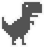

# Jogo do Dinossauro

Recriação, para estudo, do jogo do dinossauro do Chrome, feita com JavaScript e `<canvas>`.

🔗 **Jogar:** https://matheusdiamantino.github.io/Dinossauro-game/

## O que foi praticado

- **Canvas 2D** para desenhar o dinossauro e os cactos
- Loop de jogo com gravidade, pulo e detecção de colisão
- Geração aleatória de obstáculos e contagem de pontos

## Como jogar

Abra o `index.html` no navegador. Use **Espaço** ou **seta para cima** para pular.
